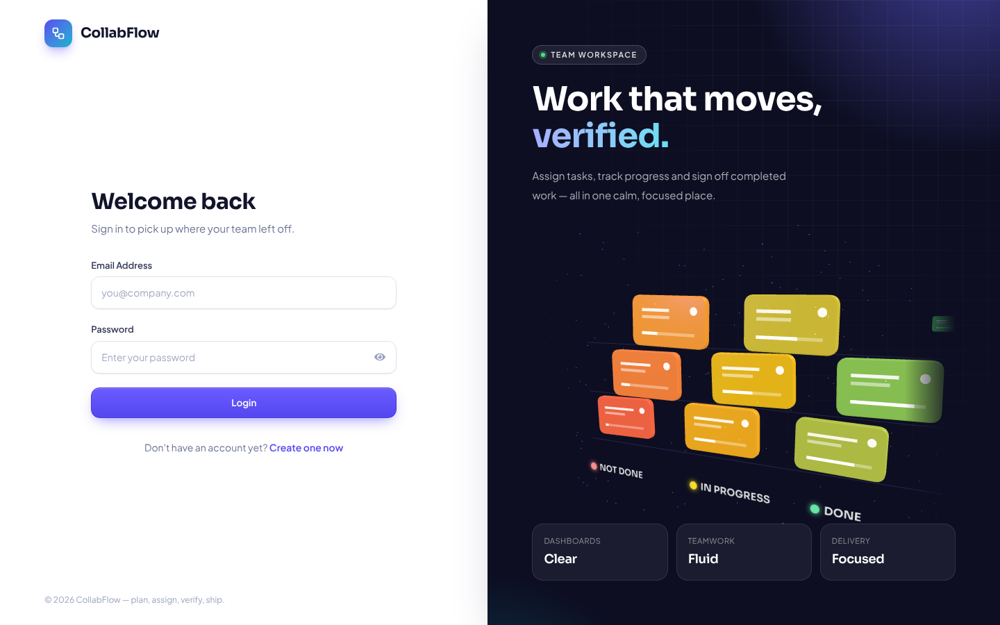
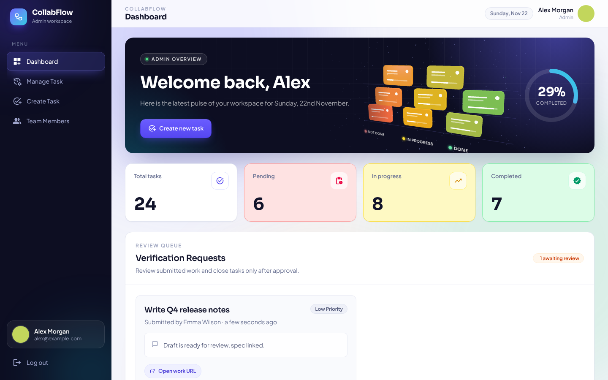
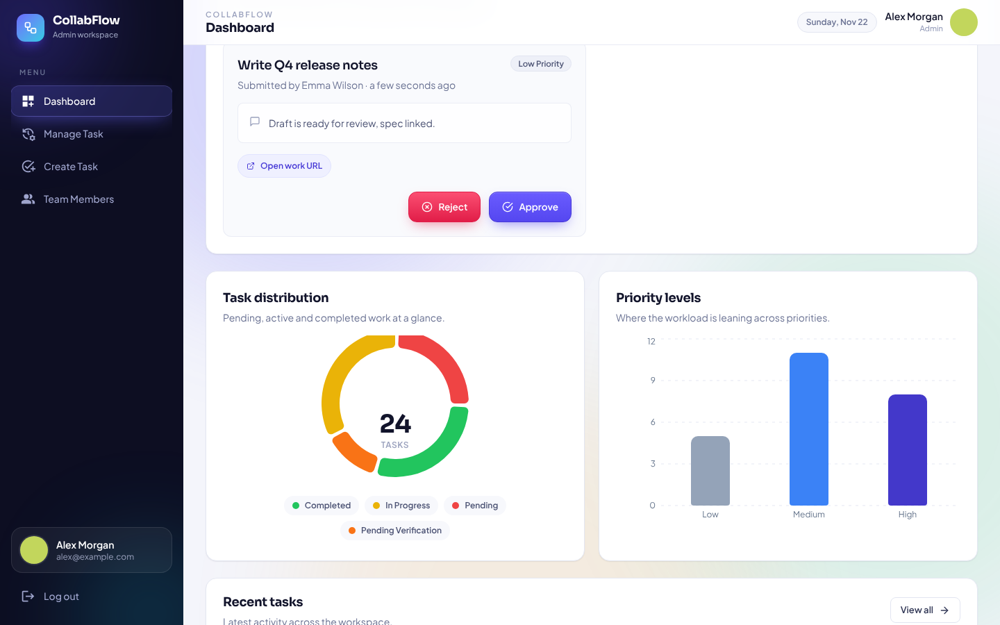
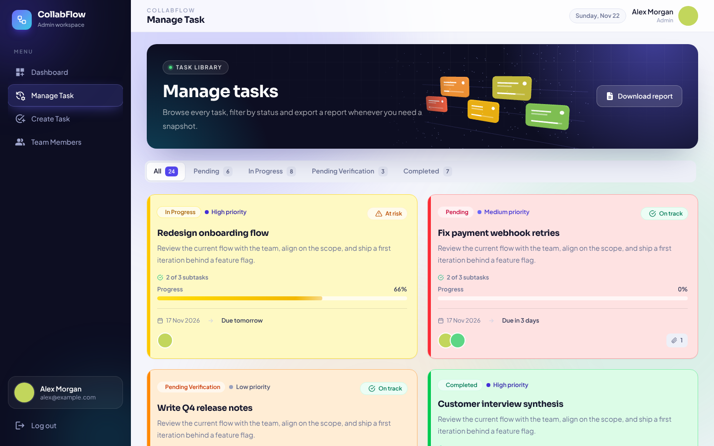
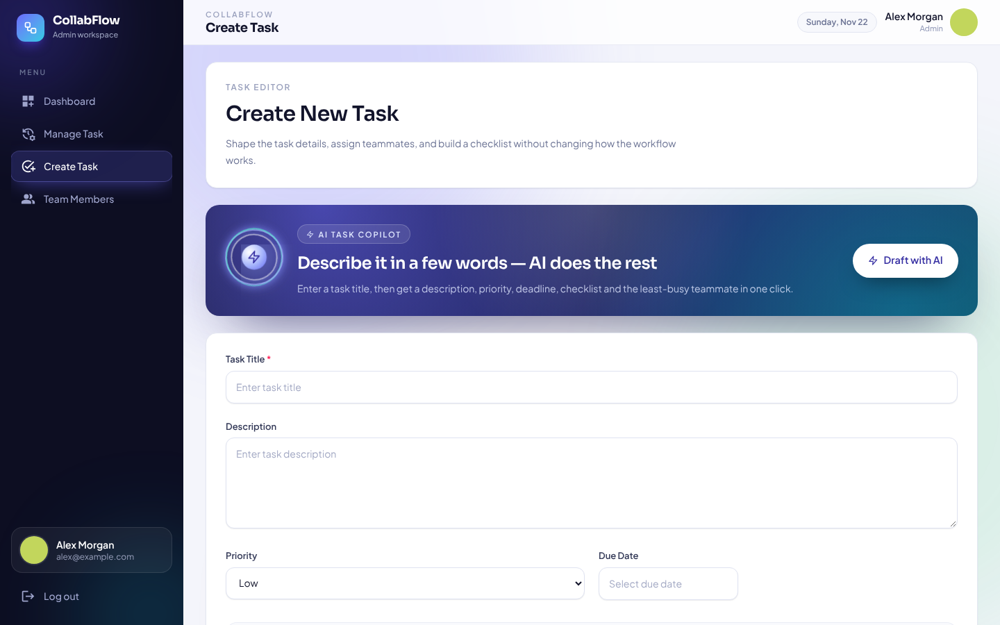
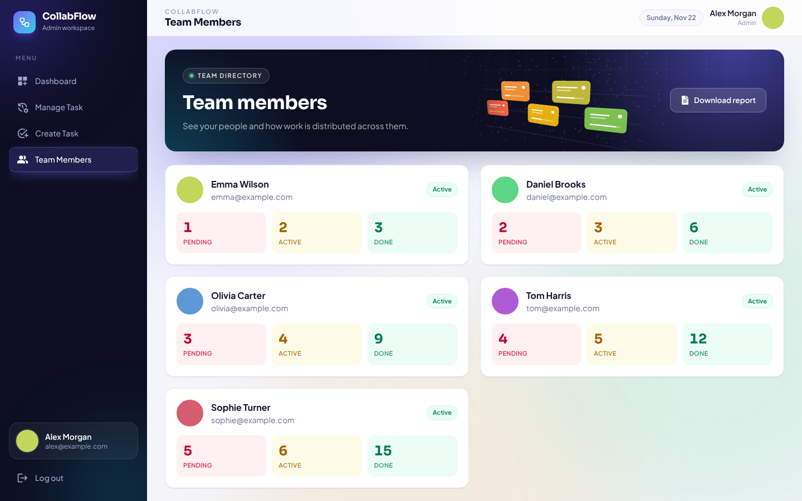
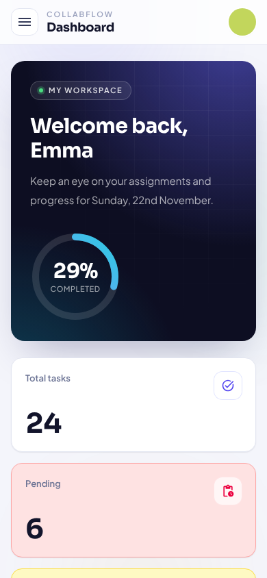

# CollabFlow

**Work that moves, verified.** A team task manager where admins create and assign tasks, members track progress and submit work, and admins verify before a task is closed. Includes an AI Task Copilot, deadline-risk badges and report exports.



## Features
- **Roles:** admin and member workspaces with separate dashboards.
- **Task management:** priorities, due dates, checklists, attachments, assignees, progress.
- **Verification flow:** members submit work with links and notes; admins approve or send back with feedback.
- **AI Task Copilot:** draft a task from a title, with suggested priority, deadline, checklist and the least-busy teammate.
- **Insights:** animated dashboards, charts, deadline-risk badges, downloadable reports.
- Polished UI: live three.js hero scene (tasks glide across the board and turn red → yellow → green as they progress), hover-lift cards in the 3D scene with NOT DONE / IN PROGRESS / DONE lanes, 3D scene banners on every page, flip-in status-coloured cards, shimmering progress bars, confetti when a task is approved, cursor-follow card highlights, animated aurora background, count-up stats, responsive layout.





**Status colours:** red = not done (pending), yellow = in progress, orange = waiting for admin review, green = done.

| Manage tasks | Create task (AI Copilot) |
|---|---|
|  |  |

| Task details | Team | Mobile |
|---|---|---|
|  |  |  |

## Run locally
Requires Node.js and a MongoDB database.

```bash
# backend
cd backend
cp .env.example .env     # fill in MONGO_URI, JWT secret, admin invite token, etc.
npm install
npm start                # http://localhost:3000

# frontend (new terminal)
cd frontend
npm install
npm run dev              # http://localhost:5173
```

**Tech:** React, Vite, Tailwind CSS, Redux Toolkit, Recharts, Node.js, Express, MongoDB.
